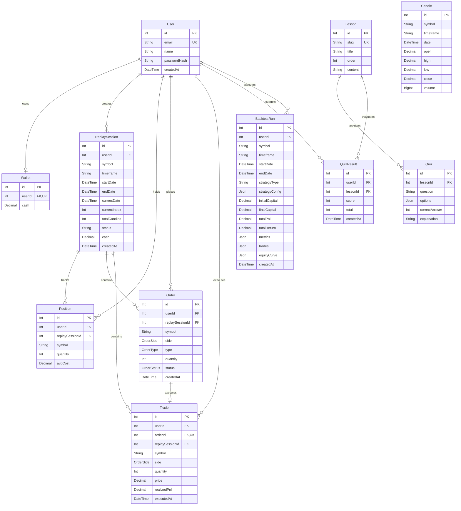

# TradeWise

An institutional-grade educational stock market simulator, market replay engine, and paper-trading platform built with a high-density financial terminal interface.

---

## Key Modules & Features

- **Institutional Financial Terminal**: High-density Obsidian Pro design (`#08090d`), tabular numerical alignment (`tabular-nums font-mono`), benchmark index ticker strip (S&P 500, NASDAQ, VIX), and real-time market status.
- **Market Discovery & Analytics**: Real-time price tracking via Yahoo Finance, interactive area and volume charts across multiple intervals (1D, 1W, 1M, 1Y, ALL), and 52-week high/low valuation bars.
- **Paper Trading Engine**: Virtual cash allocation (\$100,000 / ₹1,000,000), order ticket execution (Market & Limit orders), live positions tracking, portfolio valuation, and transaction ledger with realized P&L.
- **Interactive Learning Center**: 5 structured trading modules (Market Foundations, Exchange Mechanics, Order Types, Diversification, Risk Management) paired with interactive 5-question comprehension quizzes, immediate feedback, and progress tracking.
- **Historical Market Replay Simulator**: Candle-by-candle playback of historical price action with configurable playback speeds (1x, 2x, 5x, 10x), step controls, dedicated replay order execution, and session-specific balance tracking.
- **Algorithmic Strategy Backtesting**: Moving Average Crossover (SMA) backtesting engine evaluating historical performance, total returns, Sharpe ratio, win rate, maximum drawdown, and equity curves.

---

## Technology Stack

### Frontend
| Component | Technology |
|---|---|
| Framework | React 19 + Vite 8 |
| Styling | Tailwind CSS v4 (`@tailwindcss/vite`) + CSS Custom Properties |
| Charts & Visualization | Recharts 3 |
| Animations | Framer Motion 14 |
| Icons | Lucide React |
| Routing & Navigation | React Router 7 |
| API Client | Axios (with bearer interceptors & credentials) |
| Feedback & Notifications | React Hot Toast |

### Backend
| Component | Technology |
|---|---|
| Runtime & Server | Node.js (ES Modules) + Express.js 5 |
| Database | PostgreSQL 14+ |
| ORM & Schema Engine | Prisma 7 (`@prisma/client` + `@prisma/adapter-pg`) |
| Market Data Integration | `yahoo-finance2` |
| Authentication & Security | JSON Web Tokens (`jsonwebtoken`) + Password Hashing (`bcryptjs`) |
| Cross-Origin Security | Dynamic CORS configuration supporting all localhost ports |

---

## Architecture & Directory Layout

```text
TradeWise/
├── frontend/
│   ├── public/
│   ├── src/
│   │   ├── assets/
│   │   ├── components/
│   │   │   ├── features/       # Specialized domain components (TradeForm, ReplayChart, LessonCard, QuizWidget, etc.)
│   │   │   ├── layout/         # Terminal layouts (AppShell, Sidebar, TopBar, BottomNav, AuthLayout)
│   │   │   └── ui/             # Core design system primitives (Button, Input, Card, Badge, Modal, Table, Tabs, Skeleton)
│   │   ├── context/            # AuthContext & global state providers
│   │   ├── lib/                # Design tokens, formatters (currency, percent), and utility functions (cn)
│   │   ├── pages/              # Primary routes (Dashboard, Markets, StockDetail, Portfolio, Trade, Learn, LessonDetail, Replay, Login, Register)
│   │   ├── services/           # Axios API client instances and endpoints
│   │   ├── App.jsx             # Route definitions & ProtectedRoute boundaries
│   │   ├── main.jsx            # React root mount
│   │   └── index.css           # Tailwind v4 imports, typography, and Obsidian Pro dark theme tokens
│   ├── .env.example
│   ├── package.json
│   └── vite.config.js
│
├── backend/
│   ├── prisma/
│   │   ├── migrations/         # PostgreSQL schema migration history
│   │   ├── schema.prisma       # Complete data models and relations
│   │   └── seed_lessons.js     # Educational curriculum and quiz seeds
│   ├── src/
│   │   ├── config/             # Prisma client connection and database adapters
│   │   ├── controllers/        # Request handlers (auth, stocks, orders, trades, portfolio, lessons, replay, backtest)
│   │   ├── middleware/         # JWT authentication and request validation
│   │   ├── routes/             # Express route declarations
│   │   ├── services/           # Business logic, trading simulation, replay engine, and Yahoo Finance integration
│   │   └── server.js           # Server bootstrap, CORS setup, and route mounting
│   ├── API_DOCUMENTATION.md    # Detailed backend API reference
│   ├── .env.example
│   └── package.json
│
├── .gitignore
└── README.md
```

---

## Entity Relationship (ER) Model



---

## Local Setup & Development

### 1. Prerequisites
- **Node.js**: v20+ or v22+
- **PostgreSQL**: v14+ running locally (default port `5432`)
- **Package Manager**: npm or yarn

### 2. Backend Setup
1. Open a terminal and navigate to `backend/`:
   ```bash
   cd backend
   npm install
   ```
2. Configure `.env` in `backend/`:
   ```env
   PORT=5001
   DATABASE_URL="postgresql://<username>:<password>@localhost:5432/tradewise?schema=public"
   JWT_SECRET="your_super_secret_jwt_key_here"
   JWT_EXPIRES_IN="7d"
   ```
3. Initialize the database schema and generate Prisma client:
   ```bash
   npx prisma generate
   npx prisma migrate dev --name init
   ```
4. Seed the educational lessons and quizzes:
   ```bash
   node prisma/seed_lessons.js
   ```
5. Start the backend development server:
   ```bash
   npm run dev
   # Server runs on http://localhost:5001
   ```

### 3. Frontend Setup
1. Open a second terminal and navigate to `frontend/`:
   ```bash
   cd frontend
   npm install
   ```
2. Configure `.env` in `frontend/`:
   ```env
   VITE_API_URL=http://localhost:5001
   ```
3. Start the Vite development server:
   ```bash
   npm run dev
   # Application opens on http://localhost:5173
   ```

---

## API Endpoints Overview

Detailed payload specifications, query parameters, and response schemas are documented in [API_DOCUMENTATION.md](file:///Users/sohamdhande/Docs_Local/TradeWise/backend/API_DOCUMENTATION.md).

| Resource | Endpoints | Description |
|---|---|---|
| **Health** | `GET /api/health` | Service and database heartbeat check |
| **Auth** | `POST /api/auth/register`<br>`POST /api/auth/login`<br>`GET /api/auth/me` | User registration, authentication, and session validation |
| **Stocks** | `GET /api/stocks/search?q=:query`<br>`GET /api/stocks/:symbol/quote`<br>`GET /api/stocks/:symbol/chart?range=:range` | Symbol search, live quote, and historical chart intervals |
| **Orders** | `POST /api/orders`<br>`GET /api/orders` | Place paper trading order and retrieve user order log |
| **Trades** | `GET /api/trades` | Historical trade executions and transaction history |
| **Portfolio** | `GET /api/portfolio` | Account summary, open holdings, unrealized and realized P&L |
| **Lessons** | `GET /api/lessons`<br>`GET /api/lessons/:id`<br>`POST /api/lessons/:id/quiz` | Curriculum listing, detailed content, and quiz evaluation |
| **Replay** | `POST /api/replay/sessions`<br>`GET /api/replay/sessions/:id`<br>`POST /api/replay/sessions/:id/step`<br>`POST /api/replay/sessions/:id/order` | Interactive historical market replay and virtual trading |
| **Backtests** | `POST /api/backtests/run`<br>`GET /api/backtests` | Execute SMA crossover strategy and retrieve backtest history |
