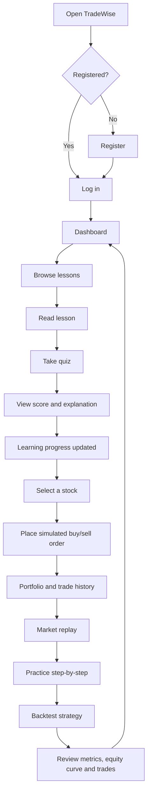

# TradeWise — User Flow

## Main journey

**Register → Learn → Practice → Replay → Backtest → Review progress**

## Key screens

- Login/Register: create an account or sign in.
- Dashboard: entry point for learning, trading and progress.
- Lessons & Quizzes: learn concepts and check understanding.
- Trade: select a stock and place a simulated order.
- Portfolio: inspect holdings, cash and trade history.
- Replay: practice with historical prices revealed progressively.
- Backtest: evaluate a supported strategy on historical data.

## Notes

- All trades in this project are simulated.
- Replay must not reveal data later than the current replay step.
- The quiz score should be saved through the agreed quiz API.
- Progress should be fetched from the agreed progress API.
